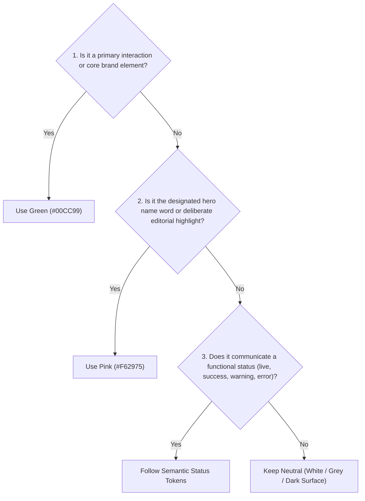

# jsondev.uk — Design System & Semantic Accent Specification

> **Source of Truth**  
> This document defines the brand identity, design tokens, visual hierarchy, and component conventions for **jsondev.uk**. All visual decisions and future changes made by developers or AI coding agents must align with this specification. When a proposed change conflicts with this document, identify and resolve the conflict explicitly rather than silently altering the system.

---

## 1. Brand Identity & Art Direction

- **Core Character**: A distinctive, immersive personal developer portfolio with a dark, technical, atmospheric aesthetic. It communicates the identity of a developer who enjoys building systems, exploring technology, and crafting intentional user experiences.
- **Tone & Mood**: Premium, deliberate, and cyber-inspired without falling into cliché cyberpunk neon tropes, generic SaaS landing page patterns, or sterile minimalism.
- **Focus**: Real projects, verified skills, and personal technical identity remain the primary focus. Accents and decorations exist solely to support context, semantic clarity, and atmosphere.
- **Visual Cadence**: High visual hierarchy, carefully controlled information density, subtle tactile depth, and crisp geometric typographic details.
- **Accent Philosophy**: Green is the primary brand signature and interaction colour. Pink provides secondary emphasis and distinction. The vast majority of the interface remains dark and neutral.

---

## 2. Colour Tokens & Palette Architecture

All color tokens originate as CSS custom properties in [src/index.css](file:///c:/Users/JP/Documents/VSCode%20files/Proyectos/jsondev.uk/src/index.css) and are exposed as Tailwind utilities in [tailwind.config.js](file:///c:/Users/JP/Documents/VSCode%20files/Proyectos/jsondev.uk/tailwind.config.js).

### A. Dark Neutrals (Canvas & Surfaces — ~85–90% of visual weight)
Dark neutrals dominate the viewport. Most text, cards, borders, and supporting UI must remain neutral.

| Token Name | Hex Value | CSS Custom Property | Tailwind Token | Semantic Role |
| :--- | :--- | :--- | :--- | :--- |
| **Canvas** | `#101110` | `--bg-canvas` | `bg-canvas`, `colors.canvas` | The master dark canvas; viewport background layer. |
| **Surface** | `#181A17` | `--bg-surface` | `bg-surface`, `colors.surface` | Base container/card background; sits directly on canvas. |
| **Elevated Surface** | `#20231E` | `--bg-surface-elevated` | `bg-surfaceElevated`, `colors.surfaceElevated` | Hover states, modals, pills, floating elements, badges. |
| **Border Subtle** | `#30342C` | `--border-subtle` | `border-borderSubtle`, `colors.borderSubtle` | Hairline card borders, section separators, divider lines. |
| **Primary Text** | `#F1F2EC` | — | `text-textPrimary`, `colors.textPrimary` | Primary headings, active copy, high-emphasis text, hero surnames. |
| **Secondary Text** | `#A2A69C` | — | `text-textSecondary`, `colors.textSecondary` | Body paragraphs, card descriptions, metadata values. |
| **Muted Text** | `#72776C` | — | `text-textMuted`, `colors.textMuted` | Timestamps, inactive labels, code commentary, breadcrumbs. |

### B. Primary Brand Accent — Caribbean Green (~8–12% of visual weight)
*Green is the primary brand identity and default interaction colour.*

| Token Name | Hex Value | CSS Custom Property | Tailwind Token | Semantic Role |
| :--- | :--- | :--- | :--- | :--- |
| **Primary Green** | `#00CC99` | `--accent-primary` | `accent.DEFAULT`, `text-accent`, `bg-accent` | Primary brand signature, primary CTA button backgrounds, active navigation links, keyboard focus indicators, ambient portrait glow, telemetry status dots, and the first given name (`Jeison`). |
| **Darker Green** | `#00B588` | `--accent-hover` | `accent.hover` | Hover and active pressed states on primary green buttons and interactive elements. |
| **Deep Green** | `#009E77` | `--accent-dark` | `accent.dark` | Active presses, deeper gradient anchors, dark ring borders. |
| **Forest Green** | `#005A44` | `--accent-deep` | `accent.deep` | Low-luminance green borders, subtle ambient shading. |
| **Bright Mint** | `#17D1A3` | `--accent-highlight` | `accent.highlight` | Highlights, active status blips, secondary telemetry markers. |
| **Pale Mint** | `#81E8CE` | `--accent-soft` | `accent.soft`, `tertiary` | High-readability tinted text, telemetry label accents, code keywords. |
| **Green-Black** | `#001611` | `--accent-green-black` | `accent.greenBlack` | Deep atmospheric ambient gradient stops behind glow sources. |
| **Green Tint / Muted** | `rgba(0, 204, 153, 0.12)` | — | `accent.muted` | Subtle badge backgrounds, hover halos, table row striping. |

### C. Secondary Accent — Vivid Pink (~1–3% of visual weight)
*Pink provides secondary emphasis and visual distinction. It is never a co-primary interaction color.*

| Token Name | Hex Value | CSS Custom Property | Tailwind Token | Semantic Role |
| :--- | :--- | :--- | :--- | :--- |
| **Secondary Pink** | `#F62975` | `--accent-pink` | `pink.DEFAULT`, `text-pink`, `bg-pink` | The hero second given name (`Porfirio`), selected project category classification (`Single-Page Web Application`), and designated secondary editorial distinctions. |
| **Pink Deep / Hover** | `#D81E63` | `--accent-pink-hover` | `pink.hover`, `pink.muted` | Hover states on pink pills, deeper tone on active pink elements. |
| **Pink Dark** | `#8A1240` | `--accent-pink-dark` | `pink.dark` | Deep subtle shadows and low-contrast borders for pink badges. |
| **Pink Soft** | `#FFB2D1` | `--accent-pink-soft` | `pink.soft` | High-contrast readable text placed on top of dark pink surfaces/badges. |
| **Pink Tint / Muted** | `rgba(246, 41, 117, 0.15)` | `--accent-pink-muted` | `pink.muted` | Background fill for pink-themed badges and classification pills. |

---

## 3. Semantic Accent Decision System

For every element that could use an accent colour, follow this decision process in strict order:



### Detailed Decision Criteria

1. **Step 1: Identity & Primary Interaction → Use Green (`#00CC99`)**
   - Is it the main call-to-action button on the page?
   - Is it a primary navigation link or active page indicator?
   - Is it an accessible keyboard focus indicator (`:focus-visible`)?
   - Is it the primary brand logo mark or terminal telemetry dot?
   - Is it the word “Jeison” in the hero title?
   - *If yes to any of the above, use Green.*

2. **Step 2: Distinction & Secondary Emphasis → Use Pink (`#F62975`)**
   - Is it the word “Porfirio” in the hero title?
   - Is it an occasional editorial highlight within an otherwise neutral section?
   - Is it a secondary action detail that is genuinely distinct from the primary green action?
   - *If yes, and there is a clear semantic justification, use Pink.*

3. **Step 3: Functional State → Use Semantic Status System**
   - Active / Live runtime status: Telemetry Green (`#00CC99` with animated pulse).
   - Inactive / Completed: Neutral grey badge (`bg-surfaceElevated text-textSecondary`).
   - Do not use pink or green purely for decorative variety where a semantic state exists.

4. **Step 4: Default → Keep Neutral**
   - Headings, body text, card backgrounds, standard borders, project descriptions, technology stack tags, and secondary buttons default to dark neutrals (`#F1F2EC`, `#A2A69C`, `#181A17`, `#30342C`).
   - If an element has no semantic interaction or classification requirement, **keep it neutral**.

---

## 4. Component-Specific Rules

### A. Hero Typography & Name Treatment
- **Typeface**: **Silkscreen Bold** (weight 700), locally bundled in WOFF2 and TTF formats.
- **Two-Scale Line Hierarchy (Exact 1.5× Ratio)**:
  - **Line 1 (Primary)**: `Jeison Porfirio` — Sized at **1.5×** of Line 2 across all breakpoints.
  - **Line 2 (Secondary)**: `Plaza Sanchez` — Sized at **⅔** (0.667×) of Line 1, left-aligned, cadence `mt-1 sm:mt-1.5`.
- **Solid Colour Mapping (No Gradients, No Fake Strokes)**:
  - `Jeison`: **Solid Caribbean Green** (`#00CC99`, `text-accent`).
  - `Porfirio`: **Solid Vivid Pink** (`#F62975`, `text-pink`).
  - `Plaza Sanchez`: **Solid Primary Text White** (`#F1F2EC`, `text-textPrimary`).
- **Responsive Size Matrix**:
  | Viewport | Primary Line (“Jeison Porfirio”) | Secondary Line (“Plaza Sanchez”) | Scale Ratio |
  | :--- | :--- | :--- | :--- |
  | Default (`<360px`) | `21px` (`leading-[1.18]`) | `14px` (`leading-[1.25]`) | **1.50×** |
  | `xs` (`360px+`) | `24px` (`leading-[1.18]`) | `16px` (`leading-[1.25]`) | **1.50×** |
  | `ss` (`620px+`) | `27px` (`leading-[1.18]`) | `18px` (`leading-[1.25]`) | **1.50×** |
  | `sm` (`768px+`) | `30px` (`leading-[1.18]`) | `20px` (`leading-[1.25]`) | **1.50×** |
  | `md` (`1060px+`) | `33px` (`leading-[1.18]`) | `22px` (`leading-[1.25]`) | **1.50×** |
  | `lg` (`1200px+`) | `36px` (`leading-[1.18]`) | `24px` (`leading-[1.25]`) | **1.50×** |
  | `xl` (`1700px+`) | `42px` (`leading-[1.18]`) | `28px` (`leading-[1.25]`) | **1.50×** |

### B. Buttons & Calls to Action
- **Primary Buttons**: Solid Caribbean Green (`#00CC99`), black text (`#101110`), font-semibold. Hover darkens to `#00B588`. **Never use pink for primary buttons.**
- **Secondary Buttons**: Neutral dark surface (`#181A17`), subtle border (`#30342C`), white text (`#F1F2EC`). Hover shifts border to `#00CC99` and text to `#FFFFFF`.
- **Ghost Buttons**: Transparent background with green hover text and subtle underline.
- **Get CV Trigger**: Custom circular button (`132px × 132px`) with green border (`rgba(0, 204, 153, 0.4)`), transparent surface fill, and green hover glow.

### C. Links & Navigation
- **Navigation Bar**: Links default to neutral `text-textSecondary` (`#A2A69C`). Hover transitions to `#FFFFFF`.
- **Active Navigation Indicator**: Bottom border or active pill in Caribbean Green (`#00CC99`).
- **In-text & Card Links**: Primary action links (`View Project Details →`) use `text-accent` (`#00CC99`), hovering to `#FFFFFF`.

### D. Project Cards & Category Classification
- **Card Background & Frame**: Solid `#181A17` background with `#30342C` border. Always neutral.
- **Project Titles & Descriptions**: Neutral typography (`#F1F2EC` and `#A2A69C`).
- **Technology Stack Badges**: Monospace neutral tags (`bg-surfaceElevated text-textSecondary border-borderSubtle`).
- **Category Badge Classification**:
  - All project category badges (“Single-Page Web Application”, “Desktop Workflow Tool”, “Desktop Study Application”) use the **Neutral Badge** style (`variant="neutral"`, `bg-surfaceElevated text-textSecondary border-borderSubtle`).
  - *Consistency Rule*: Category badges remain neutral and uniform across the Homepage project grid, Portfolio project archive, and Project Detail pages, preserving quiet metadata hierarchy while keeping chromatic emphasis reserved for primary actions and designated hero accents.

### E. Status Indicators & Badges (`<Badge />`)
- `variant="neutral"`: `bg-surfaceElevated text-textSecondary border-borderSubtle` (standard metadata).
- `variant="telemetry"`: `bg-accent/10 text-accent border-accent/30` with pulsing green dot (active system status).
- `variant="pink"`: `bg-pink/15 text-pink-soft border-pink/35` (deliberate secondary classification).
- `variant="accent"`: `bg-accent/10 text-accent border-accent/30` (section telemetry eyebrows).

### F. Icons & Decorative Elements
- **Default State**: General UI icons inherit text colour or use `text-textMuted` (`#72776C`).
- **Interactive State**: Icons inside primary buttons or links use `currentColor` and follow the parent link's hover state (`#00CC99` → `#FFFFFF`).
- **Project Identity Badges**: Dedicated project icons rendered at 36×36 px (in cards) and 44×44 px (in detail metadata cards) follow a clean, monochrome Caribbean Green (`#00CC99`) vector style. Silhouettes feature restrained line weights, geometric precision, and no decorative backgrounds or gradients, maintaining visual balance with the dark technical surfaces.
- **Brand Logos**: Official third-party logos (GitHub, LinkedIn, Notion, Ko-fi) use neutral `textSecondary` on default, hovering to `#00CC99`. Original brand vector fills are preserved.
- **Portrait Glow**: Ambient radial glow remains Caribbean Green (`rgba(0, 204, 153, 0.22)`). **No pink glow.**

---

## 5. Consistency & Anti-Pattern Rules

To prevent visual drift, the following patterns are strictly prohibited:

1. **No Interchangeability**: Green and pink are **not** co-equal choices. Green is the primary identity and interaction colour (~8–12%). Pink is a secondary emphasis accent (~1–3%).
2. **No Randomness or Alternating Quotas**: Do not alternate project cards, badges, or list items between green and pink. If two items share the same classification, they must share the same colour.
3. **No Decorative Pink Creep**: Do not add pink to a component simply because a page "lacks pink" or looks plain. Neutral content is the intended design baseline.
4. **No Pink Focus or Primary Buttons**: Accessible focus rings (`:focus-visible`) and primary submission/navigation buttons must always use the established Caribbean Green system.
5. **No Text Gradients on Hero Name**: The hero name must remain solid (`#00CC99`, `#F62975`, `#F1F2EC`) on Silkscreen Bold without gradients, text strokes, or text shadows.

---

## 6. Accessibility & Contrast Standards

All text and interactive states comply with WCAG 2.1 AA standards:

- **Primary Text (`#F1F2EC`) on Canvas (`#101110`)**: **16.5:1** (AAA)
- **Secondary Text (`#A2A69C`) on Canvas (`#101110`)**: **7.2:1** (AAA)
- **Caribbean Green (`#00CC99`) on Canvas (`#101110`)**: **8.1:1** (AAA)
- **Vivid Pink (`#F62975`) on Canvas (`#101110`)**: **5.0:1** (AA for normal text, AAA for large text `>18px`)
- **Pink Soft (`#FFB2D1`) on Canvas / Surface (`#101110`)**: **10.8:1** (AAA)
- **Keyboard Focus**: Visible `:focus-visible` ring across all interactive controls:
  ```css
  a:focus-visible, button:focus-visible, input:focus-visible, select:focus-visible, textarea:focus-visible {
    outline: 2px solid var(--accent-primary);
    outline-offset: 2px;
  }
  ```
- **Reduced Motion**: All pulsing animations and transitions respect `@media (prefers-reduced-motion: reduce)`.
- **Non-Color Exclusivity**: Status indicators always combine color with text labels or semantic iconography.

---

## 7. Implementation Architecture & Maintenance

- **Custom Properties Root**: All design tokens are registered in [src/index.css](file:///c:/Users/JP/Documents/VSCode%20files/Proyectos/jsondev.uk/src/index.css) under `:root`.
- **Tailwind Tokens**: Exposed through `theme.extend.colors` in [tailwind.config.js](file:///c:/Users/JP/Documents/VSCode%20files/Proyectos/jsondev.uk/tailwind.config.js).
- **Typography & Display Layout**: Centralized in [src/style.js](file:///c:/Users/JP/Documents/VSCode%20files/Proyectos/jsondev.uk/src/style.js).
- **Rule for Future Contributors**:
  1. Never introduce hardcoded hex colors into inline styles or one-off component classes. Always consume Tailwind tokens (`text-accent`, `text-pink`, `text-textPrimary`, `bg-surfaceElevated`).
  2. Before applying pink to any new element, verify that it passes the 4-step decision tree in Section 3.
  3. Keep `DESIGN.md` in sync whenever tokens or classification mappings are intentionally updated.
